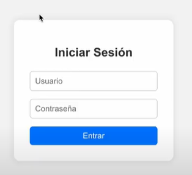
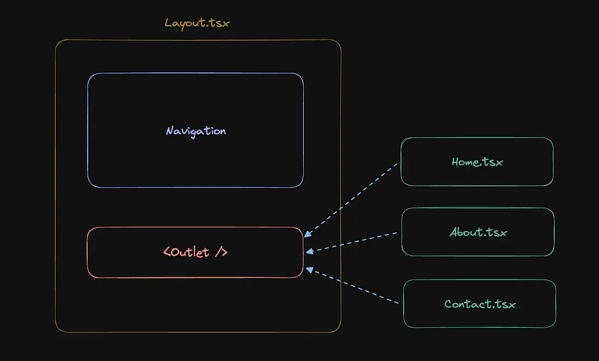
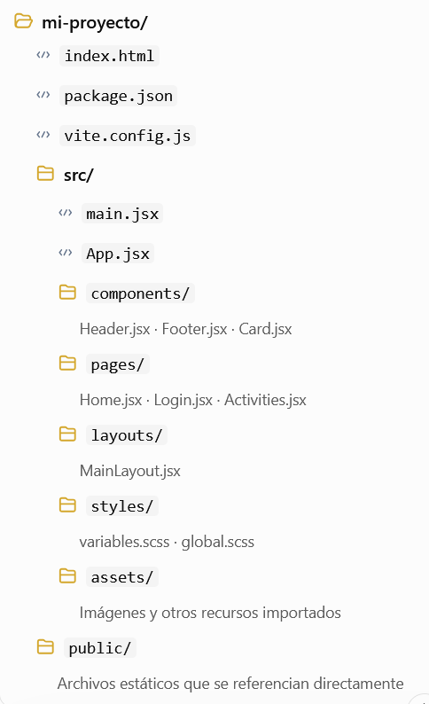

<section data-background-image="images/react/background.png">

# React
Created by <i class="fab fa-telegram"></i> 
edme88

---
<style>
.grid-container2 {
    display: grid;
    grid-template-columns: auto auto;
    font-size: 0.8em;
    text-align: left !important;
}

.grid-item {
    border: 3px solid rgba(121, 177, 217, 0.8);
    padding: 20px;
    text-align: left !important;
}

table{
  font-size: 0.6em;
}

.tableImg{
  font-size: 0.5em;
}
</style>
<!-- .slide: style="font-size: 0.80em" -->
## Temario
<div class="grid-container2">
<div class="grid-item">

* Instalar Vite
* Estructura de Carpetas
* [Instalación de React Vite](U6_react.html#/4)
* Jsx
* Hooks
* Hooks: useState
* Estado y renderizado en React
* Manejo de eventos en React
* Formularios controlados

</div>
<div class="grid-item">

* [Crear Login](U6_react.html#/11)
* Renderizado de listas en React
* Enrutamiento o Routing
* Ventajas de usar React Router
* [Redirección de Rutas](U6_react.html#/16)
* Outlet
* [Outlet](U6_react.html#/23)
* Estructura del Proyecto
* [Estructura del Proyecto](U6_react.html#/25/1)
* Imágenes
* [Imágenes](U6_react.html#/23/2)

</div>
</div>

---

### Vite

1. Ejecutar el siguiente comando para inicializar el proyecto:
```
npm create vite@latest
```
2. Colocar un nombre al proyecto
3. Seleccionar el framework: React
4. Seleccionar el lenguaje: JavaScript
5. Ingresar a la carpeta creada `cd nombre-proyecto`
6. Ejecutar `npm install`
7. Ejecutar `npm run dev`
8. Ingresar a localhost:5173

---

### Estructura de carpetas
<!-- .slide: style="font-size: 0.90em" -->
- **node_modules:** Contiene todas las dependencias que instala npm (React, Vite, ESLint, etc).
- **public:** Archivos estáticos que no pasan por el bundler de Vite. (imágenes globales, favicon, logo)
- **src:** Código fuente de React.
  - **assets:** Carpeta para imágenes, íconos o archivos CSS adicionales que sí pasan por el empaquetador.
  - **App.jsx:** Componente principal de React donde se agregan elementos y lógica.
  - **main.jsx:** Crea el root de React y monta App dentro del index.html.
- **.gitignore:** Indica qué carpetas o archivos no deben subirse al repositorio, como node_modules o .env

----

### Estructura de carpetas
<!-- .slide: style="font-size: 0.90em" -->
- **eslint.config.js:** Configuración de herramienta que analiza el código para detectar errores o malas prácticas.
- **index.html:** HTML base del proyecto. Se usa como plantilla para inyectar los bundles de JS y CSS.
- **package.json:** Archivo donde se define nombre del proyecto, dependencias y scripts que se pueden ejecutar.
- **package-lock.json:** Registra las versiones exactas de cada dependencia instalada.
- **README.md:** Archivo de documentación inicial.
- **vite.config.js:** Configuración del bundler Vite (alias, puertos, plugins).

---

### Instalación de React Usando Vite

<iframe width="560" height="315" src="https://www.youtube.com/embed/7SjTALRxnjA?si=LnK2mq4n9fEUPqFa" title="YouTube video player" frameborder="0" allow="accelerometer; autoplay; clipboard-write; encrypted-media; gyroscope; picture-in-picture; web-share" referrerpolicy="strict-origin-when-cross-origin" allowfullscreen></iframe>

---

### JSX

JSX es una sintaxis que permite escribir código similar a HTML dentro de JavaScript, usada en React para definir interfaces de usuario.

Durante la compilación, se transforma en código JavaScript que crea los elementos de la interfaz.

Sirve para:
- Describir la UI como función del estado.
- Crear componentes de forma legible y modular.
- Insertar expresiones de JavaScript dentro del marcado usando {}.

---

### Atributos que cambian de nombre
<table border="1" cellpadding="4" cellspacing="0">
  <thead>
    <tr>
      <th>En HTML</th>
      <th>En JSX</th>
      <th>Por qué</th>
    </tr>
  </thead>
  <tbody>
    <tr>
      <td>class</td>
      <td>className</td>
      <td><code>class</code> es una palabra reservada en JS (define clases).</td>
    </tr>
    <tr>
      <td>for</td>
      <td>htmlFor</td>
      <td><code>for</code> también es palabra reservada; React usa camelCase.</td>
    </tr>
    <tr>
      <td>tabindex</td>
      <td>tabIndex</td>
      <td>JSX usa camelCase para todos los atributos.</td>
    </tr>
    <tr>
      <td>onclick</td>
      <td>onClick</td>
      <td>Los eventos se escriben en camelCase y reciben funciones, no strings.</td>
    </tr>
    <tr>
      <td>onchange</td>
      <td>onChange</td>
      <td>Lo mismo, siempre en camelCase.</td>
    </tr>
    <tr>
      <td>maxlength</td>
      <td>maxLength</td>
      <td>JSX convierte todo a camelCase.</td>
    </tr>
    <tr>
      <td>readonly</td>
      <td>readOnly</td>
      <td>Igual que arriba.</td>
    </tr>
  </tbody>
</table>


---

### [Hooks](https://es.react.dev/reference/react/hooks)

Son funciones especiales que te permiten usar características de React (como estado, ciclo de vida, contexto, etc.) en componentes funcionales, sin necesidad de usar clases.

Los más comunes son:
* useState
* useEffect
* useContext
* useNavigate

---

### Hooks: useState
Permite guardar y actualizar estado local en un componente.

```react
import { useState } from 'react';

function Counter() {
  const [count, setCount] = useState(0); // estado inicial = 0

  return (
    <button onClick={() => setCount(count + 1)}>
      Clicks: {count}
    </button>
  );
}
```

----

### Estado y renderizado en React
<!-- .slide: style="font-size: 0.88em" -->
El estado (*state*) permite que un componente almacene información que puede cambiar durante la ejecución de la aplicación.

Cuando el estado cambia mediante su función de actualización, React vuelve a renderizar el componente para reflejar los nuevos valores en la interfaz.

- El estado se declara mediante **hooks** como useState.
- La función de actualización debe utilizarse para modificar el estado.
- No se debe modificar directamente una variable de estado.
- El nuevo renderizado permite que la interfaz se mantenga sincronizada con el estado.

----

### Estado y renderizado en React
**Ejemplo:** si el estado contiene el nombre ingresado en un formulario, al cambiar ese nombre React puede actualizar la interfaz para mostrar el nuevo valor.
```js
const [username, setUsername] = useState("");

<input id='username' type="text" placeholder="Usuario" 
    onChange={(e) => setUsername(e.target.value)}
    value={username}
/>
```

---

### Manejo de eventos en React

Los **eventos** permiten responder a las acciones del usuario, como hacer clic en un botón, escribir en un campo de texto o enviar un formulario.

- Los eventos se indican mediante propiedades como **onClick**, **onChange** y **onSubmit**.
- Estas propiedades reciben una función que se ejecutará cuando ocurra el evento correspondiente.
- La función puede recibir un objeto de evento (event) con información sobre lo sucedido.
- Es posible utilizar funciones existentes o definir funciones flecha directamente en JSX.

----

### Manejo de eventos en React
Pasar una función no es lo mismo que ejecutarla.

- `onClick={handleLogin}` pasa la función para que React la ejecute cuando ocurra el clic.
- `onClick={() => handleInscription(activity.nombre)}` define una función que, al ejecutarse, llama a handleInscription con el nombre de la actividad.
- `onClick={handleLogin()}` ejecuta la función durante el renderizado, en lugar de esperar al clic.

---

### Formularios controlados
<!-- .slide: style="font-size: 0.85em" -->
En React, un campo de formulario puede controlarse mediante el estado de un componente.

Un **componente controlado** es aquel cuyo valor actual está determinado por el estado de React.

Para implementarlo:
- **value** establece el valor que se muestra en el campo.
- **onChange** permite detectar los cambios realizados por el usuario.
- **event.target.value** permite obtener el valor actual del campo.
- La función de actualización de estado guarda el nuevo valor.

Este mecanismo mantiene sincronizados el campo del formulario y el estado del componente.

----

### Flujo de funcionamiento

1. React muestra el valor almacenado en el estado.
2. El usuario modifica el campo.
3. onChange captura el nuevo valor.
4. Se actualiza el estado.
5. React vuelve a renderizar el componente con el valor actualizado.

```js
const [username, setUsername] = useState("");

<input id='username' type="text" placeholder="Usuario" 
    onChange={(e) => setUsername(e.target.value)}
    value={username}
/>
```

---

### React 1: Crear un Login Básico

1. Crear un archivo **Login.jsx** similar al siguiente:



2. Al presionar **Ingresar**, si el usuario y password es 'admin', mostrar por consola "Login OK", sino "Login Incorrecto".

----

### React 1: Crear un Login Básico

3. Hacer una versión básica con **css** tradicional
4. A la altura del package ejecutar `npm install sass --save-dev`
5. Crear una carpeta de **styles** dentro de **src**
6. Adaptar el estilo al uso de **SASS**

----

### React 1: Crear un Login Básico

<iframe width="560" height="315" src="https://www.youtube.com/embed/CgZpHKvEaGg?si=0XKvTBIcz3UPBAxc" title="YouTube video player" frameborder="0" allow="accelerometer; autoplay; clipboard-write; encrypted-media; gyroscope; picture-in-picture; web-share" referrerpolicy="strict-origin-when-cross-origin" allowfullscreen></iframe>

Nota: Es **async** y no **asyn**. En nuestro caso el css estara en: ./styles/Login.scss

---

### Renderizado de listas en React

Cuando una interfaz debe mostrar varios elementos a partir de una colección de datos, se puede utilizar el método **map()** de JavaScript.

**map()** recorre un array y devuelve un nuevo array con el resultado de aplicar una función a cada elemento. En React, ese resultado puede ser una colección de elementos JSX.

----

### Renderizado de listas en React
Esto permite generar interfaces dinámicas sin escribir manualmente el mismo marcado para cada elemento.

Ventajas:
- Reduce la duplicación de código.
- Facilita la reutilización de componentes.
- Permite generar la interfaz a partir de datos que pueden cambiar.

Cada elemento de una lista renderizada debe incluir una propiedad key que permita a React identificarlo de manera estable entre renderizados.

----

### Renderizado de listas en React
Suponiendo que tenemos un array de objetos (array de actividades, con su nombre y descripción)
```js
activities.map((actividad, index) => (
    <div className="activity-card" key={index}>
        <h3>{actividad.nombre}</h3>
        <p>{actividad.descripcion}</p>
    </div>
  ))
}

```
- **map()** genera una tarjeta por cada actividad.
- **key** ayuda a React a identificar cada elemento de la lista cuando se agregan, eliminan o reordenan elementos.

---

### Enrutamiento o Routing

Es el proceso de definir cómo una aplicación web maneja diferentes URL o rutas que el usuario puede visitar

Cuando el usuario hace clic en un enlace o escribe directamente la URL en la barra de direcciones, React Router actualiza la interfaz sin recargar toda la página, esto se logra manipulando el historial del navegador y utilizando componentes de React para cambiar el contenido dinámicamente, todo del lado del cliente.

---

### Enrutamiento o Routing

Para poder utilizar el enrutamiento es necesario instalar la dependencia:

```
npm install react-router-dom
```

Te recomiendo leer la documentación [routing](https://reactrouter.com/start/declarative/routing)

---

### Ventajas de usar React Router

<!-- .slide: style="font-size: 0.70em" -->

- La navegación se vuelve fluida y sin interrupciones, y se maneja del lado del cliente.
- Permite navegar sin recargar toda la página, actualizando solo la parte necesaria del contenido, haciendo la navegación más rápida.
- Permite definir rutas específicas dentro de la aplicación como /home, /about , etc. También define rutas dinámicas que pueden contener parámetros variables como /products/:id donde el id es un identificador.
- Accede a los parámetros de ruta, lo cual es útil al momento de tener filtros, búsquedas o detalles de productos.
- Protege ciertas rutas con la finalidad de que solo los usuarios autenticados puedan acceder a ellas, permitiendo un mayor control sobre qué se muestra en cada ruta.
- Se puede crear rutas anidadas o subrutas, permitiendo una estructura más compleja y jerárquica.
- Soporta redirecciones automáticas y las rutas no encontradas (404).
- Es compatible con SEO (motores de búsqueda).

---

### React 2: Redirección de Rutas

1. Ejecutar `npm install react-router-dom`
2. Si el login es exitoso redireccionar a "/actividades"
3. Use la siguiente información para crear una pantalla donde se pueda mostrar adecuadamente

```javaScript
const activities = [
  {
    nombre: "taekwondo",
    descripcion: "Arte marcial coreana",
    horarios: [
      { dia: 2, "hora-inicio": "18:30", "hora-fin": "20:00" },
      { dia: 4, "hora-inicio": "18:30", "hora-fin": "20:00" }
    ]
  },
  {
    nombre: "zumba",
    descripcion: "ritmos latinos",
    horarios: [
      { dia: 1, "hora-inicio": "19:30", "hora-fin": "20:30" },
      { dia: 3, "hora-inicio": "19:30", "hora-fin": "20:30" }
    ]
  }
];

const diasSemana = ["Domingo", "Lunes", "Martes", "Miércoles", "Jueves", "Viernes", "Sábado"];


```

----

### React 2: Redirección de Rutas (parte 1)

<iframe width="560" height="315" src="https://www.youtube.com/embed/j46p0NoWjZY?si=jpK0yCt8NHRbmC0o" title="YouTube video player" frameborder="0" allow="accelerometer; autoplay; clipboard-write; encrypted-media; gyroscope; picture-in-picture; web-share" referrerpolicy="strict-origin-when-cross-origin" allowfullscreen></iframe>

----

### React 2: Redirección de Rutas (parte 2)

<iframe width="560" height="315" src="https://www.youtube.com/embed/TE-QTgIujU4?si=-uZlDTV6VjjIuU2Y" title="YouTube video player" frameborder="0" allow="accelerometer; autoplay; clipboard-write; encrypted-media; gyroscope; picture-in-picture; web-share" referrerpolicy="strict-origin-when-cross-origin" allowfullscreen></iframe>

---

### Outlet

Permite que los componentes de una ruta principal rendericen los componentes de sus rutas hijas. 
Esto facilita la creación de estructuras de navegación complejas en aplicaciones React, donde una ruta principal puede compartir un diseño común y luego renderizar contenido diferente según la ruta secundaria activa. 

---

### Outlet




---

### Outlet: Ejemplo

Este componente es una plantilla común para varias páginas. Contiene partes que son compartidas, como el header, el nav y el footer.

```jsx
// Layout.js
import { Outlet } from 'react-router-dom';

const Layout = () => {
  return (
    <div>
      <header>My App Header</header>
      <nav>Navigation Bar</nav>
      <main>
        <Outlet /> {/* Content specific to the route will be rendered here */}
      </main>
      <footer>My App Footer</footer>
    </div>
  );
};

export default Layout;

```

---

### Outlet: Enrutamiento Ejemplo

- path='/' → usa el componente Layout como base.
- `<Outlet />` en Layout decidirá qué mostrar según la ruta hija.
- index → muestra Home en la raíz (/).
- path='about' → muestra About en /about.
- path='contact' → muestra Contact en /contact.

```jsx
// App.js
<Routes>
  <Route path="/" element={<Layout />}>
    <Route index element={<Home />} />
    <Route path="about" element={<About />} />
    <Route path="contact" element={<Contact />} />
  </Route>
</Routes>
```

---

### Estructura de Proyectos React
En React no existe una única estructura o forma de implementar el proyecto. 
La organización depende del tamaño de la aplicación y de cómo se relacionan sus funcionalidades.

Estructura recomendada dentro de **src**:
- components
- pages
- layouts
- styles
- assets

----

### Estructura de Proyectos React
<!-- .slide: style="font-size: 0.90em" -->
- **components/**	Componentes de interfaz reutilizables o independientes de una página concreta. Ejemplo: Header.jsx, Footer.jsx, Card.jsx
- **pages/**	Componentes que representan las distintas páginas o vistas de la aplicación, generalmente asociada a una ruta.
- **layouts/**	Estructuras compartidas entre páginas, como encabezado, navegación, contenido principal y pie.
- **styles/**	Estilos globales, variables SCSS, reset CSS y otros estilos compartidos.
- **assets/**	Imágenes, iconos, fuentes y otros recursos importados desde el código.
- **public/**	Archivos estáticos que deben servirse directamente, sin importarlos desde JavaScript.

----



---

### Renderizado condicional en React

Permite mostrar diferentes elementos de la interfaz según se cumpla o no una condición.

Como JSX admite expresiones JavaScript, podemos utilizar operadores y estructuras de control para decidir qué contenido mostrar.

----

### Renderizado condicional: If
Permite elegir entre dos alternativas según una condición.

```jsx
{condicion ? (
  <p>Se cumple la condición</p>
) : (
  <p>No se cumple la condición</p>
)}
```

- Si la condición es **verdadera** (true), se muestra la primera alternativa.
- Si es **falsa** (false), se muestra la segunda.

----

### Renderizado condicional: If
Ejemplo:
```jsx
{isLoggedIn ? (
  <button onClick={logout}>Cerrar sesión</button>
) : (
  <a href="/login">Login</a>
)}
```

----

### Renderizado condicional: AND &&
Permite mostrar un elemento solamente cuando una condición es verdadera.

```jsx
{condicion && <p>Se cumple la condición</p>}
```

- Si la condición es **verdadera**, se muestra el elemento.
- Si es **falsa**, no se muestra ese elemento.

----

### Renderizado condicional: AND &&
Ejemplo:
```jsx
{isLoggedIn && (
  <button onClick={() => handleInscription(activity.nombre)}>
    Inscribir
  </button>
)}
```

---

### React 3: Outlet

1. Crear un componente de **Header**, donde haya un menú de navegación con: Home, Login, Actividades
2. Crear un componente de **Footer**
3. Crear un **layout** que renderice Header, Main, Footer. El contenido de main puede variar acorde se selecicone /login o /actividades o /Home.
4. En la página de actividades, mostrar el botón de inscripción solo si el usuario está logueado.
5. Si el usuario está logueado, mostrar en **Header** el botón de **Logout**.

---

### React 3: Outlet

<iframe width="560" height="315" src="https://www.youtube.com/embed/YvN3uB1zR7g?si=IUkh6BYRZx-ulCML" title="YouTube video player" frameborder="0" allow="accelerometer; autoplay; clipboard-write; encrypted-media; gyroscope; picture-in-picture; web-share" referrerpolicy="strict-origin-when-cross-origin" allowfullscreen></iframe>

---

### Estructura del Proyecto

En los proyectos de react se recomienda emplear la siguiente estructura:
- **components:** Componentes reutilizables, como el Header, Footer o el Layout.
- **pages:** Vistas o páginas principales.
- **styles:** Archivos css.

---

### Ejercicio Estructura del Proyecto

1. Dentro de la carpeta **src** cree 3 subcarpetas:
  - components
  - pages
  - styles
2. Re-organice los archivos en las carpetas correspondientes
3. Modifique los imports y verifique que la página funciona correctamente.
4. Modifique **vite.config.js** para mejorar los imports usando **alias**

----

### Ejercicio Estructura del Proyecto

<iframe width="560" height="315" src="https://www.youtube.com/embed/IzvzIbWZNhI?si=HJAcJ-ZelaypBEe5" title="YouTube video player" frameborder="0" allow="accelerometer; autoplay; clipboard-write; encrypted-media; gyroscope; picture-in-picture; web-share" referrerpolicy="strict-origin-when-cross-origin" allowfullscreen></iframe>

---

### React: Imágenes

Las imágenes pueden colocarse en:
- **src/assets**: importar la imagen y usar src={nombreImagen}. Vite procesa estos recursos durante la compilación.
- **public**: referenciar la imagen mediante una ruta absoluta desde la raíz

----

### React: Imágenes
<table border="1" cellpadding="8" cellspacing="0" class="tableImg">
  <thead>
    <tr>
      <th>Opción</th>
      <th>Ventajas</th>
      <th>Desventajas</th>
    </tr>
  </thead>
  <tbody>
    <tr>
      <td><strong>src/assets (importando)</strong></td>
      <td>
        <ul>
          <li>Se procesan y optimizan en el build (mejor performance).</li>
          <li>Evita errores de rutas relativas.</li>
          <li>Permite lazy loading y dinámicas.</li>
          <li>Más modular: cada componente gestiona sus imágenes.</li>
        </ul>
      </td>
      <td>
        <ul>
          <li>Debes importar cada imagen manualmente.</li>
          <li>No se pueden acceder directamente por URL en HTML o redes sociales.</li>
        </ul>
      </td>
    </tr>
    <tr>
      <td><strong>public/ (ruta directa)</strong></td>
      <td>
        <ul>
          <li>Permite usar rutas absolutas (ej: <code>/images/foto.jpg</code>).</li>
          <li>Útil para HTML directo, metadatos (og:image), favicon, etc.</li>
          <li>No requiere importación en JSX.</li>
        </ul>
      </td>
      <td>
        <ul>
          <li>No se optimizan en el build.</li>
          <li>Puede causar errores de ruta si se renombra/mueve algo.</li>
          <li>No hay verificación estática en tiempo de compilación.</li>
        </ul>
      </td>
    </tr>
  </tbody>
</table>

---

### React: Imágenes

1. Dentro de **public** crea una carpeta de home y guarda 2 imágenes
2. Dentro de **assets** crea una carpeta de home y guarda 2 imágenes
3. En la **Home** reemplaza el texto por una estructura de 4 cards, cada una con una imágen y el título de la actividad.

----


----

### React: Imágenes

<iframe width="560" height="315" src="https://www.youtube.com/embed/_FJLuPxzPCA?si=swYehpLSH1LI6lla" title="YouTube video player" frameborder="0" allow="accelerometer; autoplay; clipboard-write; encrypted-media; gyroscope; picture-in-picture; web-share" referrerpolicy="strict-origin-when-cross-origin" allowfullscreen></iframe>

---

### Properties: comunicación entre componentes
<!-- .slide: style="font-size: 0.90em" -->
Las **props** permiten que un componente reciba información desde el componente que lo utiliza.

- Se pueden utilizar para enviar datos, funciones y otros valores.
- El componente hijo recibe las props y puede utilizarlas para construir su interfaz o ejecutar acciones.
- Las props son de solo lectura: el componente hijo no debe modificarlas.
- El flujo de datos habitual es unidireccional: desde el componente padre hacia el hijo.

Si un componente hijo necesita solicitar una acción al padre, puede invocar una función recibida mediante props.

---

### React: Children

La *prop* **children** permite que un componente reciba el contenido que se coloca entre sus etiquetas de apertura y cierre.

- Permite crear componentes reutilizables y flexibles.
- El contenido puede ser texto, elementos JSX u otros componentes.
- Se accede mediante la prop children, igual que a cualquier otra prop.

----

### React: Children
Ejemplo: una tarjeta recibe el nombre y la descripción de una actividad, además de una función que permite inscribirse en ella.

----

### React: Children

Ejemplo de creacion del componente:
```
  Card({ title, children }) {
  return (
    <article>
      <h2>{title}</h2>
      <div>{children}</div>
    </article>
  );
}
```

Ejemplo de uso del componente:
```
<Card title="Taekwondo">
  <p>Arte marcial coreana.</p>
  <p>Martes y jueves a las 18:30.</p>
</Card>
```


---

### Ejercicio: Children
1. Cree un componente **Card** que permita mostrar las actividades del gym El mismo debe recibir: título, subtítulo e información en un **children**.
2. Separe la "data" en un archivo separado para mantener el orden de los componentes.

---
## ¿Dudas, Preguntas, Comentarios?

