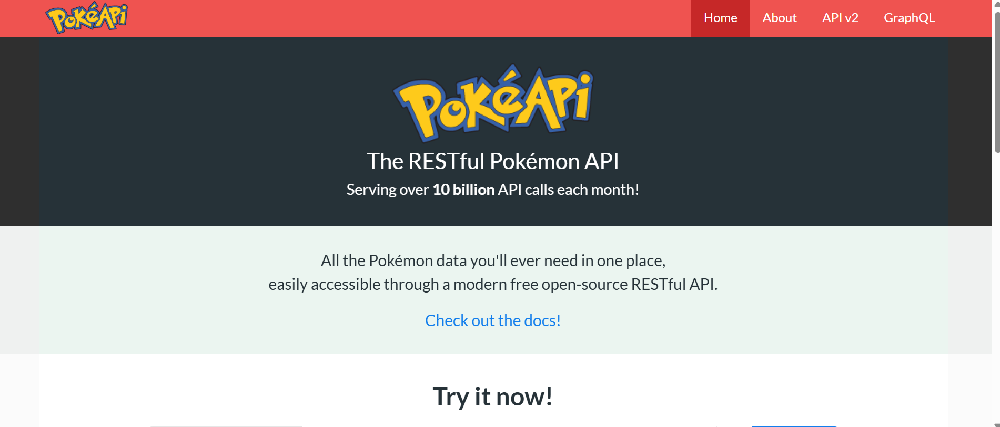

# Mock APIs
Created by <i class="fab fa-telegram"></i>
edme88

---
<!-- .slide: style="font-size: 0.60em" -->
<style>
.grid-container2 {
    display: grid;
    grid-template-columns: auto auto;
    font-size: 0.8em;
    text-align: left !important;
}

.grid-item {
    border: 3px solid rgba(121, 177, 217, 0.8);
    padding: 20px;
    text-align: left !important;
}
</style>
## Temario
<div class="grid-container2">
<div class="grid-item">

- json-server
- .json()
- Ejercicio: Mock del Backend
-

</div>
<div class="grid-item">

- OpenApi
- Swagger
- PokeAPI
- Postman

</div>
</div>

---

### [json-server](https://www.npmjs.com/package/json-server)
JSON Server es una herramienta de Node.js que permite crear una API REST simulada a partir de un archivo JSON, sin necesidad de desarrollar un backend.

---

### .json()
El método **.json()** se utiliza para leer y convertir el cuerpo de una respuesta HTTP que contiene JSON en un objeto o array de JavaScript.

```js
const response = await fetch(url); //Obtiene la respuesta del servidor
const data = await response.json();
```

---

### Ejercicio: Mock del Backend
1. En la carpeta donde se encuentre el **package.json** ejecutar:
```bash
npm i -D json-server
```
2. Crear el archivo **src/data/activities.json** con la información necesaria para mockear el servicio.
3. Emplear una terminal para levantar el servidor:
```bash
npx json-server --watch src/data/activities.json --port 4000
```
4. Modificar el código para que en lugar de leer los datos del **js** se realice un **fetch**

---

### OpenAPI 
<!-- .slide: style="font-size: 0.90em" -->
Es una especificación estándar y abierta para describir APIs HTTP, especialmente APIs REST, de forma estructurada y legible tanto por personas como por herramientas.
- **Documentación estandarizada:** describe endpoints, métodos HTTP, parámetros, esquemas de datos, autenticación y respuestas.
- **Interoperabilidad:** permite que distintas herramientas interpreten la definición de una API.
- **Generación automática:** facilita crear documentación, clientes y servidores a partir de la especificación.
- **Pruebas interactivas:** permite explorar y ejecutar solicitudes a los endpoints desde una interfaz gráfica.

---

### Swagger 
Es un conjunto de herramientas que utiliza la especificación OpenAPI.

Herramientas y Ejemplos
- [Swagger Editor](https://editor.swagger.io/): permite escribir, validar y visualizar definiciones OpenAPI.
- [Swagger UI](https://petstore.swagger.io/): genera documentación interactiva y permite probar los endpoints de una API.
- [OpenAPI Specification:](https://www.openapis.org/) sitio oficial de la especificación.

---

### Swagger UI
<!-- .slide: style="font-size: 0.80em" -->
Es una herramienta que genera automáticamente una interfaz web interactiva a partir de una definición OpenAPI. Permite visualizar, comprender y probar una API sin necesidad de utilizar herramientas externas como Postman.

Principales funcionalidades:
- **Exploración de endpoints:** muestra los recursos disponibles y los métodos HTTP asociados (GET, POST, PUT, PATCH, DELETE).
- **Consulta de documentación:** presenta parámetros, tipos de datos, estructuras de las solicitudes y posibles respuestas.
- **Ejecución de solicitudes:** permite completar parámetros, encabezados y cuerpos de las peticiones, y ejecutarlas directamente desde el navegador mediante Try it out.
- **Visualización de respuestas:** muestra el código de estado HTTP, los encabezados y el contenido devuelto por el servidor.

---

### PokeApi

Para los siguientes ejercicios vamos a usar la [pokeApi](https://pokeapi.co/)



Puedes ver APIS gratuitas en: https://publicapis.dev/

---

### [Postman](https://www.postman.com/downloads/)

Es una herramienta que permite:

- Probar APIS
- Documentarlas
- Testear APIs
- Monitorear servicios, etc

---

### Ejercicio
1. Ingresar a https://pokeapi.co/api/v2/pokemon/1
2. Analizar brevemente la información obtenida
3. Empleando POSTMAN realizar un GET a la misma URL
4. Analizar los datos obtenidos

---

### Ejercicio: APIs en React

1. Crear un archivo **Poke** en *src/page*
2. Crear un archivo **PokeCard** en *src/components* 
3. En **Poke** emplear el *fetch* para obtener los datos de bulbasaur. Usar el *useEffect* para poder visualizar esos datos.

---

### Spread operator
El operador de propagación o extensión, que se escribe como puntos suspensivos *...* cumple múltiples funciones:
1. Copiar arrays (copia superficial / shallow copy)
```js
const original = [1, 2, 3];
const copia = [...original];
// copia es [1, 2, 3] (un array nuevo) 
```
2. Concatenar o combinar arrays
```js
const frutas = ['manzana', 'pera'];
const verduras = ['zanahoria', 'lechuga'];
const comida = [...frutas, ...verduras]; 
// ['manzana', 'pera', 'zanahoria', 'lechuga']
```

----

### Spread operator

3. Añadir elementos a un array
```js
const numeros = [2, 3, 4];
const conCero = [1, ...numeros, 5]; 
// [1, 2, 3, 4, 5]
```
4. Pasar elementos como argumentos a una función
```js
function sumar(a, b, c) {
  return a + b + c;
}
const numeros = [1, 2, 3];
console.log(sumar(...numeros)); // 6
```

----

### Spread operator

5. Copiar y fusionar objetos
```js
const usuario = { nombre: 'Ana', edad: 25 };
const clonUsuario = { ...usuario, ciudad: 'Madrid' };
// { nombre: 'Ana', edad: 25, ciudad: 'Madrid' }
```

---

### Actualización de estados con arrays
```js
setProductos((prev) => [...prev, data]);
```

Esta instrucción agrega un nuevo elemento (data) al array almacenado en el estado, sin modificar directamente el array original.

- **prev:** representa el estado anterior (el array actual).
- **...prev:** copia todos los elementos del array anterior.
- **data:** es el nuevo elemento que se agrega al final.

---

### Ejercicio: APIs en React

1. Cree una nueva funcion, **fetchAllPokemons** para llamar a la API de 1 a 20

---

### ¿Cómo re-armarías el carrito de compras usando Vite-React?

----

### Carrito

1. Si aún no tenemos instalado **json-server** en el **package.json** ejecutar:
```bash
npm i -D json-server
```

----

### Carrito
2. Crear **db.json** dentro de **src/data** para separar datos de lógica, y mockear
el servicio **get**.
```json
{"products":[
    {
        "id": "1",
        "nombre": "Cabezal Sparring",
        "description": "Cabezal de Sparring.",
        "categoria": "Protectores",
        "marca": "Gran Marc",
        "talle": [
            "1",
            "2",
            "3"
        ],
        "precio": 35000,
        "web": "https://www.granmarctiendaonline.com.ar/productos/cabezal-cerrado/",
        "imagen": "cabezal-cerrado.webp"
    },
    {
        "id": "2",
        "nombre": "Dobok Dan",
        "description": "Dobok aprobado para torneos internacionales.",
        "categoria": "Dobok",
        "marca": "Daedo",
        "talle": [
            "1",
            "2",
            "3",
            "4",
            "5",
            "6",
            "7",
            "8"
        ],
        "precio": 115000,
        "web": "https://www.daedo.com/products/taitf-10813",
        "imagen": "dobok.webp"
    },
    {
        "id": "3",
        "nombre": "Escudo de Potencia",
        "description": "Escudo de potencia para entrenamientos.",
        "categoria": "Entrenamiento",
        "marca": "Gran Marc",
        "talle": [
            "s/talle"
        ],
        "precio": 51700,
        "web": "https://www.granmarctiendaonline.com.ar/productos/escudo-de-potencia-grande/",
        "imagen": "escudo-potencia.webp"
    },
    {
        "id": "4",
        "nombre": "Par de focos redondos",
        "description": "Par de focos de 25cm x 25cm para hacer entrenamiento.",
        "categoria": "Entrenamiento",
        "marca": "Gran Marc",
        "talle": [
            "s/talle"
        ],
        "precio": 15000,
        "web": "https://www.granmarctiendaonline.com.ar/productos/foco-con-dedos/",
        "imagen": "foco-con-dedos.webp"
    },
    {
        "id": "5",
        "nombre": "Guantes 10 onzas",
        "description": "Guantes de Sparring de 10 onzas habilitados para torneos internacionales",
        "categoria": "Protectores",
        "marca": "Daedo",
        "talle": [
            "s/talle"
        ],
        "precio": 35000,
        "web": "https://www.daedo.com/products/pritf-2020",
        "imagen": "protectores-manos.webp"
    },
    {
        "id": "6",
        "nombre": "Protectores Pie",
        "description": "Protectores de Pie habilitados para torneos internacionales",
        "categoria": "Protectores",
        "marca": "Daedo",
        "talle": [
            "XXS",
            "XS",
            "S",
            "M",
            "L",
            "XL"
        ],
        "precio": 35000,
        "web": "https://www.daedo.com/collections/collection-itf-gloves/products/pritf-2022",
        "imagen": "protectores-pie.webp"
    }
],
"cart":[]}
```

----

### Carrito
3. Crear un archivo  **.env** en la base y guardar la URL del servicio
```json
VITE_BASE_URL = "http://localhost:4000/"
```
4. Crear una carpeta **api** dentro de **src** y crear:
   - getProducts (GET /products)
   - getCart (GET /cart)
   - addToCart (POST /cart)
   - updateQty (PATCH /cart/:id)
   - removeItem (DELETE /cart/:id)
   - deleteCart (DELETE /cart)
3. En el **package.json** agregar el siguiente **script** para levantar el servidor:
```bash
"services": "npx json-server src/data/db.json --port 4000"
```
4. En la terminal, ejecutar ```npm run services```
5. Crear un **Store.jsx** en */pages* que contenga .map para iterar y generar las tarjetas de productos (llamar a **getProducts**)

Y otra terminal para levantar el proyecto:
```bash
npm run dev
```

----

### Carrito
6. Crear función **formatPrice** en **src/utils**
7. Agregar un **modal** para la ventana con detalle del producto.
8. Desde cada tarjeta de producto llamar al **addToCard**
8. Crear una interfaz para **Cart.jsx** donde se haga uso de: getCart, updateQty, removeItem y deleteCart. Emplear [google icon](https://fonts.google.com/icons) para los botones

---
## ¿Dudas, Preguntas, Comentarios?

